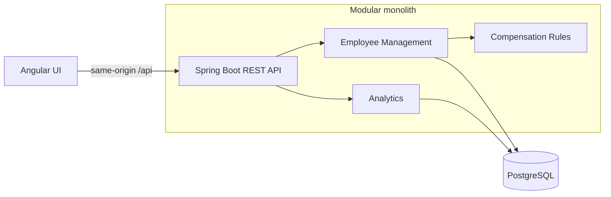

# ACME Employee Salary Management

An HR application for managing current salaries for 10,000 employees across multiple countries, built for the Incubyte Engineering Assessment. Employee changes flow through the directory and currency-separated compensation reports.

- Create and edit employees with validation and stale-edit protection.
- Search, filter, sort, and paginate employee records on the server.
- Analyze headcount and salary totals, averages, minimums, and maximums by department or country.
- Keep money exact and currencies separate; no implicit conversion.
- Use session login, CSRF protection, and 10,000 deterministic synthetic employees.

**Stack:** Java 21, Spring Boot 4.1.1, Maven Wrapper 3.9.11, PostgreSQL 18.6, Flyway; Angular/Material 22.2.3, TypeScript 6, Node 24.22.0, npm 11.19.1. Tests use JUnit/Mockito, Testcontainers, and Vitest.

## Architecture



Docker serves the production Angular build through Nginx, which proxies API requests to Spring Boot. Development uses the Angular server's API proxy. See [architecture and decisions](docs/ARCHITECTURE.md).

## Quick Start — Docker (Recommended)

Install Docker with Compose v2 and start the Docker engine. From the repository root:

```sh
docker compose up --build
```

The first build downloads dependencies. PostgreSQL becomes healthy, Flyway applies migrations, the backend seeds an empty database, and the frontend starts after backend readiness.

| Service | URL |
| --- | --- |
| Application | http://127.0.0.1:4200 |
| Backend API | http://127.0.0.1:8080/api/v1 |
| Readiness | http://127.0.0.1:8080/api/v1/health |

**Demo login:** `demo.hr` / `DemoSalary-Only-2026!`

These credentials and the database defaults are intentionally public, for local review with synthetic data only. Published ports bind to loopback; PostgreSQL has no published port. This is not a production deployment. No `.env` file or host Java/Node installation is needed.

The `salary-management-demo` Compose project uses its own persistent volume. First startup inserts exactly **10,000 employees**; subsequent starts preserve all existing records and HR edits, even if the count has changed. The initial dataset size is not an application limit.

```sh
# In another terminal: status and initial seed count
docker compose ps
docker compose exec db psql -U salary_demo -d salary_demo -c 'SELECT count(*) FROM employees;'

# Stop and remove containers, retaining database data
docker compose down

# Reset ONLY this demo project's data, then recreate the initial dataset
docker compose down --volumes
docker compose up --build
```

Ctrl+C stops an attached run. To change occupied host ports, use `DEMO_FRONTEND_PORT=4300 DEMO_BACKEND_PORT=8081 docker compose up --build`; open the corresponding URLs. `DEMO_DB_PASSWORD` optionally overrides the demo database password on initial volume creation; changing it does not change an existing database role's password.

## Manual Setup (Without Docker)

Commands below use a POSIX shell and start from the repository root. On Windows use equivalent environment assignments and `mvnw.cmd`.

### 1. Prerequisites

Install **JDK 21**, **PostgreSQL 18** (including `psql` and `createdb`), **Node 24.22.0**, and **npm 11.19.1**. Set `JAVA_HOME` to JDK 21 and put its `bin` and Node/npm on `PATH`. No global Maven or Angular CLI is required.

```sh
java -version
node --version
npm --version
(cd backend && ./mvnw -version)
```

### 2. Start and configure PostgreSQL

Start your installed PostgreSQL service using your OS/package manager. It must listen on `127.0.0.1:5432`; the commands below assume an administrator role named `postgres` (substitute your administrator if different). Run these once for a fresh database:

```sh
psql -h 127.0.0.1 -U postgres -d postgres -c "CREATE ROLE salary_local LOGIN PASSWORD 'LocalDemo-Only-2026!';"
createdb -h 127.0.0.1 -U postgres -O salary_local salary_management_local
```

Load the committed **public local-demo** configuration in each backend/seed terminal. It includes the demo login's BCrypt hash; never use these settings for real salary data.

```sh
set -a
. ./.env.example
set +a
```

For private configuration, provide `DB_URL`, `DB_USERNAME`, `DB_PASSWORD`, `HR_USERNAME`, and `HR_PASSWORD_HASH` through your environment; see [backend configuration](backend/TECHNICAL_DOCUMENTATION.md#configuration).

### 3. Build, migrate, and seed

```sh
(cd backend && ./mvnw -DskipTests package)
./scripts/seed-employees.sh
```

The seed command automatically applies and validates Flyway migrations, inserts 10,000 employees, and exits without an HTTP server. It deliberately **fails on a nonempty employee table**; skip this command when restarting an already seeded database. Migration-only initialization also happens during normal backend startup.

### 4. Start the backend

```sh
"$JAVA_HOME/bin/java" -jar backend/target/salary-management-0.0.1-SNAPSHOT.jar \
  --spring.profiles.active=local --server.address=127.0.0.1
```

Keep this terminal open. The `local` profile permits cookies over local HTTP; the default requires HTTPS.

### 5. Start the frontend

In another terminal, from the repository root:

```sh
cd frontend
npm ci
npm start
```

### 6. Open the application

Open **http://127.0.0.1:4200** and sign in with the demo account above. The development proxy forwards `/api` to port `8080`. Stop each application with Ctrl+C; PostgreSQL data remains in your installed database.

## Running Tests

```sh
# Backend unit tests; no Docker required
(cd backend && ./mvnw test)

# Full backend build + unit + isolated PostgreSQL/HTTP integration tests
# Requires a running Docker engine; never uses the demo/development database
(cd backend && ./mvnw verify)

# Frontend tests, production build, and formatting (after npm ci)
(cd frontend && npm test)
(cd frontend && npm run build)
(cd frontend && npm run format:check)

# Validate container configuration
docker compose config --quiet
```

Integration tests run automatically during `verify` via Failsafe. See [verification evidence and limitations](docs/VERIFICATION.md) and the [behavioral coverage review](docs/COVERAGE_REVIEW.md). Native setup works without Docker; the integration suite still requires it.

## Additional Documentation

- [One-page requirements](docs/REQUIREMENTS.md)
- [Backend technical documentation](backend/TECHNICAL_DOCUMENTATION.md)
- [Architecture, decisions, trade-offs, and future expansion](docs/ARCHITECTURE.md)
- [API contracts and business rules](docs/API.md)
- [Database schema](docs/DATA_MODEL.md)
- [Assumptions and open questions](docs/ASSUMPTIONS.md)
- [Frontend development](frontend/README.md) and [conventions](docs/FRONTEND.md)
- [AI usage notes](docs/AI_USAGE.md)

Public hosting, production HTTPS/proxy verification, and the submission video remain pending. The local Docker demo makes the complete application reviewable; Step 24 security, performance, and code-quality review remains separate.
