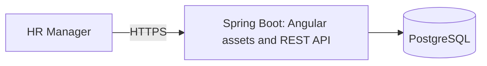

# Architecture and Engineering Decisions

**Status:** Approved project design for the MVP. Incubyte's clarification remains pending; this is not a statement of additional assessment requirements. Application implementation has not started.

## Context and Goals

The [requirements baseline](REQUIREMENTS.md) covers current employee salary management and predefined compensation reporting for 10,000 employees across multiple countries. The design prioritizes monetary correctness, readable code, testable business rules, and reliable delivery. Open product rules remain in [ASSUMPTIONS.md](ASSUMPTIONS.md).

## Architecture Choice

Use a modular monolith: one Spring Boot application, an Angular UI, and PostgreSQL. Organize the backend by feature, with layers inside features where useful. Use one backend build project and one application database; logical boundaries do not require separate Maven modules or databases.

| Alternative | Benefit | Trade-off | Decision |
| --- | --- | --- | --- |
| Application-wide controller/service/repository packages | Familiar, simple starting point | A feature's behavior becomes scattered across global layers | Keep these responsibilities within feature boundaries instead. |
| Modular monolith | Clear responsibilities, local calls, straightforward transactions, one deployment | Boundaries depend on code structure and review | Selected for the current scope. |
| Microservices | Independent deployment and scaling | Network failures, distributed consistency, and operational overhead | No present requirement justifies these costs. |

Prefer Java 21, Spring Boot, Spring Web MVC, Spring Data JPA, Jakarta Bean Validation, PostgreSQL, Flyway, and Maven for the backend; modern Angular, TypeScript, Angular Material, Reactive Forms, and HttpClient for the UI. Spring Security is approved for the access design below. Exact versions, test tooling configuration, dependency installation, and scaffolding require their own approved steps. Modern Angular acceptance remains an external clarification item.

## Responsibilities and Boundaries

| Area | Owns | Boundary |
| --- | --- | --- |
| Employee management | Employee identity, department/country details, listing, search, and employee use cases | Coordinates employee workflows; does not duplicate compensation rules. |
| Compensation | Salary amount/currency validation and current compensation changes | Keeps monetary rules out of controllers and UI components. |
| Analytics | Read-only summaries and database aggregation queries | Does not change employee or compensation records. |
| Security | Authentication, sessions, and access enforcement | Application code must not rely on frontend guards as authorization. |
| Infrastructure | Persistence configuration, migrations, seeding, and operational configuration | Supplies technical integration without becoming a general-purpose business module. |

The approved [data model](DATA_MODEL.md) uses `employees`, `departments`, `countries`, and `currencies`. Current salary fields belong to the employee record; employee management owns its entity and repository, while compensation owns salary validation/change rules. Employee application services coordinate combined changes in one transaction. Logical boundaries do not require a separate compensation table or endpoint.

Analytics may query employees and their reference tables through dedicated read projections. We accept internal schema coupling to keep reporting efficient and straightforward. Persistence changes must therefore review affected analytics queries and tests. Controllers should not reach into another feature's repositories; cross-feature business coordination belongs in services.

Within a feature, controllers translate HTTP requests and responses, application services coordinate use cases and transactions, and repositories perform persistence. DTOs define API input/output; do not serialize persistence entities as public contracts. Start with manual mapping for small DTOs. Do not add mapper libraries, service interfaces, or factories without a concrete need.

Keep monetary calculations and validation independently testable. Spring and JPA integration can remain pragmatic; this design does not require a second framework-free entity model or repository abstraction for every operation.

The Angular UI should follow the same feature responsibilities, with typed API services, reactive forms, and clear loading, empty, and error states. Share components when reuse exists. UI validation improves feedback; backend validation remains authoritative. The approved [API contract](API.md) uses `/api/v1`, decimal strings for money, integer strings for IDs/versions, application-owned page responses, and Problem Details errors.

## Runtime and Deployment Structure

Build Angular into static assets packaged with Spring Boot for production. This creates one application deployment plus PostgreSQL and one public origin for browser/API traffic. Spring Boot supports static resources and an index page; client-side route fallback still needs explicit implementation. The fallback must preserve API/authentication errors and missing-asset responses rather than return the UI for every unknown URL.

During development, run Angular separately and proxy backend requests through its development server. Use relative API URLs so browser requests follow the same-origin pattern.

The trade-off is coupled frontend/backend releases and a build process that assembles both artifacts. A later move to separate static hosting can retain the API boundary but requires packaging, routing, and security configuration changes. Hosting provider, HTTPS termination, build commands, and Docker use remain undecided. No deployment or remote infrastructure is created by this design step.

## Demo Access

Use Spring Security with one configured HR account and session-based login. Protect employee and analytics APIs, including reads. Provide login and logout through the UI. Supply the username and password hash through deployment configuration; keep credentials out of the repository and application logs. Account registration, password recovery, user administration, and advanced RBAC remain outside the MVP.

Use an HTTP-only session cookie, secure over HTTPS in deployment, with `SameSite=Lax` and a 30-minute idle timeout. Retain CSRF protection. The [API contract](API.md) defines token initialization, login, session inspection, and logout, with a separate readable `XSRF-TOKEN` cookie and `X-XSRF-TOKEN` header. Refresh the token after login/logout; the authentication cookie stays HTTP-only. Spring Security handlers return API status/problem bodies instead of HTML redirects.

| Alternative | Trade-off |
| --- | --- |
| HTTP Basic | Less UI work, but awkward browser logout behavior. |
| Session login | Selected: conventional login/logout with server-side session management; requires correct cookie and CSRF integration. |
| External identity provider | Additional account/service configuration beyond the current demo need. |

Spring Security is justified by protecting sensitive operations and reads. This decision approves its purpose; it does not install dependencies in this step.

A shared configured account provides no individual attribution. In-memory sessions support the initial single-instance application; a restart requires login again. Multiple application instances would require an explicit session strategy. Use synthetic data exclusively; this demo access model is not a complete production HR identity-management system.

## Data, Money, and Transactions

Use Java `BigDecimal` and PostgreSQL `NUMERIC(19,4)` for positive gross annual base salary with explicit ISO currency codes. Validate currency-specific precision before persistence, because PostgreSQL can round excess scale. Reject non-finite values explicitly. Preserve currencies and separate monetary aggregation by currency. Do not infer currency from employment country or introduce conversion rates.

Paginate and aggregate in PostgreSQL rather than loading the entire dataset into the application or browser. Select indexes from the approved query patterns. Use versioned Flyway migrations and database constraints alongside application validation.

Application services define transaction boundaries for use cases. The employee record has one JPA optimistic-lock version; full updates must carry/check the version originally edited by the client, returning `409` on a stale edit. Required fields, foreign keys, unique employee numbers, case-insensitive department uniqueness, and initial filter indexes are specified in [DATA_MODEL.md](DATA_MODEL.md). The [API contract](API.md) defines validation, conflict responses, decimal-string money, and minor-unit `HALF_EVEN` average rounding. Each analytics response uses a consistent database snapshot. Executable implementation remains a later approved step.

## Verification Strategy

- Test observable business rules with fast, deterministic unit tests and Red -> Green -> Refactor where applicable.
- Verify persistence, constraints, pagination, and aggregation against PostgreSQL; do not assume a substitute database proves PostgreSQL behavior.
- Check analytics against independently calculated fixtures, including separate currencies and empty groups.
- Test API validation and access enforcement, login/logout/session behavior, and CSRF failures.
- Test important Angular forms, listing/filtering interactions, and loading/error states; verify the integrated UI/API workflow.
- Measure the realistic 10,000-record workload before making performance claims. Performance targets and integration-test environment setup remain open.

These are planned checks, not executed application tests. The documentation step checks scope consistency, local links, whitespace, and secret patterns.

## Future Expansion

| Change | Extension path | Accepted current limit |
| --- | --- | --- |
| Salary history and audit records | Add effective-dated records/audit persistence through migrations; revise update and reporting semantics | Current-value editing provides no history or attribution trail. |
| RBAC and individual identities | Extend the security boundary with user identities, permissions, and authorization tests | One HR account has uniform access. |
| CSV import/export | Reuse validation and use-case rules; define duplicate handling and partial-failure behavior | No file-transfer workflow is implemented. |
| Currency conversion | Add rate sources, effective dates, and an explicit rounding/reporting policy | No single monetary total spans currencies. |
| Larger datasets | Measure queries, tune indexes and pagination, then consider scaling based on evidence | No claim of readiness for 100,000 or one million employees. |
| Separate frontend deployment or multiple backend instances | Revisit asset hosting/security configuration and session handling | One application deployment and local sessions simplify the MVP. |

Clear boundaries make changes easier to locate; they do not guarantee future features will require no refactoring. Do not introduce speculative infrastructure or abstractions to implement these extension paths now.

## References

- [Spring Boot servlet web applications and static resources](https://docs.spring.io/spring-boot/reference/web/servlet.html)
- [Spring Security session management](https://docs.spring.io/spring-security/reference/servlet/authentication/session-management.html)
- [Spring Security CSRF and SPA integration](https://docs.spring.io/spring-security/reference/servlet/exploits/csrf.html)
- [Angular security and HttpClient CSRF integration](https://angular.dev/best-practices/security)
