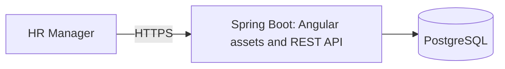

# Architecture and Engineering Decisions

**Status:** Approved project design for the MVP. Incubyte's clarification remains pending; this is not a statement of additional assessment requirements. The backend, PostgreSQL/Flyway foundations, employee creation/retrieval/editing through HTTP/service/persistence, session/CSRF security, and authenticated reference-data lookup are implemented. Paginated employee search with department/country/currency filters and allowlisted sorting is also implemented. Compensation analytics is implemented through HTTP/service/PostgreSQL aggregation; the UI remains planned.

## Context and Goals

The [requirements baseline](REQUIREMENTS.md) covers current employee salary management and predefined compensation reporting for 10,000 employees across multiple countries. The design prioritizes monetary correctness, readable code, testable business rules, and reliable delivery. Open product rules remain in [ASSUMPTIONS.md](ASSUMPTIONS.md).

## Architecture Choice

Use a modular monolith: one Spring Boot application, an Angular UI, and PostgreSQL. Organize the backend by feature, with layers inside features where useful. Use one backend build project and one application database; logical boundaries do not require separate Maven modules or databases.

| Alternative | Benefit | Trade-off | Decision |
| --- | --- | --- | --- |
| Application-wide controller/service/repository packages | Familiar, simple starting point | A feature's behavior becomes scattered across global layers | Keep these responsibilities within feature boundaries instead. |
| Modular monolith | Clear responsibilities, local calls, straightforward transactions, one deployment | Boundaries depend on code structure and review | Selected for the current scope. |
| Microservices | Independent deployment and scaling | Network failures, distributed consistency, and operational overhead | No present requirement justifies these costs. |

The backend bootstrap uses Java 21, Spring Boot 4.1.1, Spring MVC, and Maven Wrapper pinned to Maven 3.9.11 under `backend/`, with package `com.acme.salarymanagement`. The test starter follows Boot's managed JUnit Jupiter 6 and Mockito versions; the user approved JUnit 6 in place of the original JUnit 5 preference. The wrapper verifies the Maven distribution with a pinned SHA-256 checksum.

PostgreSQL 18.6 runs locally through Docker Compose with loopback access and a persistent project volume. The backend uses the Boot Flyway starter, PostgreSQL-specific Flyway module, and JDBC driver. Testcontainers supplies isolated PostgreSQL databases for integration tests, run by Maven Failsafe during `verify`. Credentials are external to Git; application startup requires configured PostgreSQL and successful migrations.

Spring Data JPA is implemented for employee persistence and immutable reference-data mappings. Spring Security uses Boot's managed 7.1.1 version. Jakarta Bean Validation uses Boot's validation starter for required HTTP fields. Modern Angular, TypeScript, Angular Material, Reactive Forms, and HttpClient remain the frontend direction; version selection and Angular acceptance are still pending. The [README](../README.md) documents Java selection, build, database setup, and local execution.

## Responsibilities and Boundaries

| Area | Owns | Boundary |
| --- | --- | --- |
| Employee management | Employee identity, department/country details, listing, search, and employee use cases including synthetic bulk creation | Coordinates employee workflows; does not duplicate compensation rules. |
| Reference data | Supported department, country, and currency catalogs and their read API | Migration-controlled records; employee validation and forms use the same catalogs. |
| Compensation | Salary amount/currency validation and current compensation changes | Keeps monetary rules out of controllers and UI components. |
| Analytics | Read-only summaries and database aggregation queries | Does not change employee or compensation records. |
| Security | Authentication, sessions, and access enforcement | Application code must not rely on frontend guards as authorization. |
| Infrastructure | Persistence configuration, migrations, command startup, and operational configuration | Supplies technical integration without becoming a general-purpose business module. |

The approved [data model](DATA_MODEL.md) uses `employees`, `departments`, `countries`, and `currencies`. Current salary fields belong to the employee record; employee management owns its entity and repository, while compensation owns salary validation/change rules. Employee application services coordinate combined changes in one transaction. Logical boundaries do not require a separate compensation table or endpoint.

Analytics may query employees and their reference tables through dedicated read projections. We accept internal schema coupling to keep reporting efficient and straightforward. Persistence changes must therefore review affected analytics queries and tests. Controllers should not reach into another feature's repositories; cross-feature business coordination belongs in services.

Within a feature, controllers translate HTTP requests and responses, application services coordinate use cases and transactions, and repositories perform persistence. DTOs define API input/output; do not serialize persistence entities as public contracts. Start with manual mapping for small DTOs. Do not add mapper libraries, service interfaces, or factories without a concrete need.

Keep monetary calculations and validation independently testable. Spring and JPA integration can remain pragmatic; this design does not require a second framework-free entity model or repository abstraction for every operation.

`EmployeeCreationService` implements the first use case. It normalizes and validates input, resolves controlled reference records, invokes framework-free `SalaryRules`, and saves the employee in one transaction. The repository flushes inside the service so the exact employee-number unique constraint can be translated into a business conflict, including concurrent requests. Other integrity failures retain their original classification. No existence pre-check is required for correctness.

Reference repositories expose single-record and ordered catalog lookup only; their JPA mappings are immutable and have no public mutation methods. Employee/result mapping is small and manual. Application values use `Long`, `BigDecimal`, and `Instant`; HTTP DTOs explicitly implement string serialization and input parsing rather than expose persistence entities. `EmployeeDetails` supplies the six editable values to creation and editing. `EmployeeDataResolver` shares normalization, reference resolution, and monetary validation; `EmployeeWriteConflicts` shares precise unique-constraint translation. No generic CRUD layer is introduced.

The creation controller and DTOs live in `employee.api`; shared JSON configuration and controller error handling live in `api`. The controller delegates to the existing service. `@Valid` checks required fields, while the request mapper parses a positive integer-string department ID. Name normalization/Unicode limits, reference checks, and salary rules stay in the existing application code. Response mapping uses explicit strings for exact IDs, versions, money, and UTC timestamps. This small amount of manual mapping isolates the HTTP contract without a mapper dependency.

JSON configuration rejects unknown fields, trailing tokens, and number/boolean-to-string coercion across JSON API requests; form login is unaffected. Controller advice maps validation, duplicate conflicts, missing/stale employees, and MVC failures to the same Problem Details shape as security handlers. It omits rejected values, parser/database messages, and query strings. Unexpected failures log their exception type only; this limits diagnostic detail to avoid logging sensitive payloads.

`EmployeeQueryService` retrieves one employee and maps its application result inside a read-only transaction. A repository entity graph on `findById` fetches department, country, and currency with the employee; a PostgreSQL integration check verifies one prepared query and zero entity writes. The endpoint reuses `EmployeeResponse`, so creation and retrieval share exact string/UTC formatting. `PositiveId` centralizes the small parsing rule now needed by both department IDs and employee path IDs. Missing records have a specific business exception mapped to `404 EMPLOYEE_NOT_FOUND`.

The read-only transaction is a framework/database optimization hint, not an immutable domain model. Tests also compare the persisted record before and after retrieval. Fetching the three lookup records adds joins but avoids later lazy-loading queries and works with Open Session in View disabled. The query boundary and returned version support the future editing form; the backend update workflow is implemented separately.

`EmployeeUpdateService` loads the target through `findForEditById`, checks the submitted version, resolves/validates all replacement values, then mutates the managed entity and flushes in one transaction. ID, creation timestamp, and JPA-managed version cannot be assigned by the request. Invalid values and unique conflicts roll back the entire replacement. Only effective changes update employee fields/metadata; decimal comparison ignores insignificant trailing zeros for no-change detection.

The edit query uses `LockModeType.OPTIMISTIC` on the employee without a fetch graph. Applying that lock to fetched unversioned lookup entities caused a provider error in testing; lookups are resolved separately for editing. Plain retrieval retains its efficient graph. Optimistic verification persists through commit, protecting unchanged submissions as well as writes. Explicit version mismatches and JPA/Spring optimistic failures map to `409 STALE_EMPLOYEE`; there is no automatic retry or forced version increment.

`ReferenceDataQueryService` reads the three small supported catalogs through ordered repository queries in one read-only transaction. It maps entities to typed application results inside that transaction; `referencedata.api` owns the controller and explicit HTTP DTOs, including exact string department IDs and integer minor units. Departments are ordered by database name/ID, countries/currencies by code. The existing security configuration protects the endpoint without new exceptions or CSRF requirements for GET.

One combined response simplifies form initialization and keeps catalog values aligned with backend validation. Three small reads and manual DTO mapping are accepted; there is no cache, pagination, or administration API. Catalogs remain controlled through migrations, so the default transaction isolation is sufficient for the current use case; this is not an atomic-snapshot guarantee for live catalog administration. New supported records can be added through reviewed migrations without Angular hardcoding. Large or dynamically administered catalogs would require separately approved pagination, consistency, and cache-invalidation decisions.

`EmployeeQueryService.list` accepts validated page/size/search/filter values and returns an application-owned page result. It counts employees first, computes offsets/totals using long arithmetic, and fetches only an in-range page. The paged repository query fetches the three to-one lookup relationships through an entity graph; there are no collection fetches or per-row lookup queries. Tests verify one count plus one bounded content query for populated pages and count only for out-of-range pages, along with employee load counts and zero entity writes. Counting before fetching avoids JPA offset conversion for very large empty pages. JPA's integer offset range still limits genuinely populated deep windows at multi-billion-row scale; cursor pagination would require a new contract.

`EmployeePageParameters` strictly parses `page`, `size`, optional `q`, the three optional catalog filters, and optional `sort`, rejecting duplicate/unsupported parameters. Department IDs reuse `PositiveId`. `EmployeePageRequest` keeps pagination/sort rules and delegates shared search/filter normalization to `EmployeeReadCriteria`. That record owns the search length/null-character rules, department bounds, optional code normalization, and literal LIKE escaping. `EmployeeCriteriaValidator` performs the catalog checks reused by listing and analytics, inside each calling service transaction. `ReferenceCode` shares the existing ASCII-before-uppercase country/currency rules with employee writes; null filters remain absent, while supplied blank codes are invalid. The HTTP page DTO reuses `EmployeeResponse`, keeping Spring pagination types and persistence entities out of the JSON contract. Ordering defaults to employee number/ID and supports the six approved fields in either direction, always retaining ID ascending as the final tie-breaker. No extra dependency, index, or generic search framework is introduced. Search/filtering uses two parameterized JPA query methods with one shared predicate, so count and page retrieval apply identical conditions. The employee-number OR full-name expression is grouped before the three optional AND filters. Both field and pattern are lowercased by PostgreSQL. `EmployeeReadCriteria.likePattern()` escapes `!` first, then LIKE wildcards `%`/`_`, using explicit `ESCAPE '!'`; no user text becomes query structure. Null/blank search imposes no search restriction; the existing unfiltered path remains when all search/filter criteria are absent. Normalization strips surrounding Unicode whitespace and validates 200 code points/null characters before persistence access.

The service verifies provided catalog records before count/content queries, independent of employee/search matches. This adds at most three catalog reads; tests verify five total selects for an in-range page with all filters, four out of range, bounded employee loads, and zero writes. No per-row validation or lookup query is added.

A shared constant keeps these fixed optional conditions small without a generic query framework. The filter-combination test initially exposed `lower(bytea)` when the search pattern was null in this PostgreSQL/Hibernate configuration. Explicit [String casts supported by Hibernate](https://docs.jboss.org/hibernate/orm/7.0/querylanguage/html_single/Hibernate_Query_Language.html) give the nullable function argument a text type; all eight filter subsets are tested with and without search. More complex future criteria may justify revisiting query composition. Existing indexes and transaction isolation remain unchanged. Substring search plans and performance need measurement with the seeded workload before adding specialized index support.

`EmployeeSort` represents supported fields/directions using enums, independent of HTTP strings and persistence paths. The parser accepts exactly one case-sensitive `field,direction` pair; the service uses an exhaustive mapping to fixed JPA properties, including `department.name`, `country.code`, and `currency.code`. No client string is passed to Spring Data as a property/expression. Existing repository methods accept the validated ordering through `PageRequest`, so predicate/count logic stays unchanged. Every primary order appends `id ASC`, including descending order. Text ordering follows database collation.

`EmployeePageRequest` enforces the salary-sort currency requirement before querying, including for non-HTTP callers and empty/no-match results. Existing filter validation verifies the supplied currency catalog entry. Sorting therefore compares stored numeric salaries only within the selected currency; no conversion is introduced. Tests distinguish numeric values such as 2/10 and verify ties with insertion/employee-number orders that differ. All fields/directions are exercised through plain and searched query paths, and persistence checks verify bounded rows and no additional per-row reads.

A new sort field requires an enum member, an approved public alias, a service property mapping, and behavior tests; the exhaustive switch makes a missing service mapping a compile-time issue. This explicit boundary is sufficient for one selected sort. Future locale-specific ordering, multiple selected fields, or new indexes need separate contract/query decisions and measurements.

Offset pagination with a separate count is a simple fit for the current target. Counts still inspect matching rows, and deep offsets become more expensive as data grows; measure before changing indexes or pagination. The existing read-only transaction uses default isolation, so concurrent commits may affect count/content queries independently and no snapshot across page requests is promised. Stronger consistency, if required later, would need an explicit isolation/snapshot decision and concurrency tests.

The Angular UI should follow the same feature responsibilities, with typed API services, reactive forms, and clear loading, empty, and error states. Share components when reuse exists. UI validation improves feedback; backend validation remains authoritative. The approved [API contract](API.md) uses `/api/v1`, decimal strings for money, integer strings for IDs/versions, application-owned page responses, and Problem Details errors.

## Compensation Analytics Read Path

`CompensationAnalyticsService` validates shared employee criteria, executes one grouped read through `CompensationAggregateRepository`, then delegates exact arithmetic to framework-free `CompensationRollup`. `CompensationQuery` defaults to department grouping and no filters; the grouping enum permits only department/country. The existing listing request shape/constructors are retained while shared rules move into employee-owned read helpers. Analytics does not depend on listing pagination or salary-sort restrictions.

The repository uses the existing transaction-aware `JdbcTemplate`. PostgreSQL calculates `count`, unrestricted numeric `sum`, `min`, and `max` per dimension/currency group. Only fixed enum-selected column/join fragments enter SQL text; every search/filter value is bound with an explicit JDBC VARCHAR/BIGINT type, including nulls. Group labels and currency minor units are read in that same statement. Department IDs stay numeric for ordering and become exact string keys in results. Country groups order by code; both dimensions then order by currency code. No employee entities or raw employee lists are materialized.

The rollup combines only these aggregate rows by currency, using exact `BigDecimal` totals and headcounts. Averages divide exact totals by counts and round once with `HALF_EVEN` at currency minor units; rounded group averages never feed currency averages. Totals/minimums/maximums use `UNNECESSARY` scale conversion to preserve exact values rather than hide invalid stored precision. Currency summaries order by code. Headcount may span currencies; monetary summaries never do. Empty data creates no synthetic groups or zero-valued salary statistics.

One grouped statement supplies both result levels, so no second summary query can observe a different employee dataset. A read-only service transaction uses the existing default isolation; stronger multi-statement snapshot isolation is unnecessary for this design. A coordinated PostgreSQL test lets a writer commit after the aggregate read and before rollup, then checks both result levels retain that read. This consistency claim is specific to the analytics response; listing still has separate count/content queries as documented above.

SQL is intentionally coupled to the PostgreSQL schema. The native and JPA predicates remain explicit representations of the same rules, sharing normalized criteria/escaping and catalog validation; parity tests compare all filter combinations and literal searches. Persistence/policy changes must review both query forms. Java rollup work grows with the number of groups, not employees. Larger group cardinality or additional dimensions may justify SQL rollups later, based on measurements. No dependency, schema migration, cache, or materialized summary is added.

The application result uses typed grouping and currency-scaled `BigDecimal` values. `CompensationController` exposes authenticated `GET /api/v1/analytics/compensation`. `CompensationParameters` allowlists the five supported query names, rejects repeated values, maps exact lowercase grouping names, and reuses `PositiveId` and `EmployeeReadCriteria`. Absent grouping defaults to department; supplied invalid grouping is a field error. Pagination and sorting parameters are rejected. The small single-value reader remains local to the parser, matching the existing listing parser without introducing a generic query framework.

`CompensationResponse` maps application values to dedicated HTTP records: lowercase grouping, integer counts, exact string keys, and plain currency-scale decimal strings. It performs no calculation or persistence access. This boundary allows later transport changes without changing the calculation model. Existing session authentication, cache prevention, CSRF policy, and Problem Details handling apply unchanged; reads need no CSRF token. Real HTTP/PostgreSQL tests verify the contract and access behavior. No new dependency, configuration, or schema migration is needed.

## Explicit Synthetic Data Loading

`scripts/seed-employees.sh` invokes the same executable JAR with `--seed-employees`. The application entry point selects a non-web context, obtains the seed service, and closes the context after completion or failure. It accepts no extra seed-mode arguments; database configuration comes from the existing environment variables. Normal startup is unchanged and never calls the seed service. No HTTP seed endpoint, startup runner, seed migration, dependency, or alternate packaging is introduced.

Employee management owns `EmployeeSeedGenerator` and `EmployeeSeedService` because they form an employee bulk-creation use case and reuse package-local `EmployeeInput` validation. The generator is framework-free and fixes the record count, country order, department names, curated names, illustrative salary bands, and random seed. It resolves current department IDs/currency precision from catalogs, avoiding hardcoded migration IDs or catalog iteration order. The six-country dataset uses typical local currencies as a demo choice, not a new country/currency business restriction. Reproducibility covers business data for unchanged code/catalog metadata on Java 21, excluding server-generated IDs/timestamps.

The service owns one transaction. A PostgreSQL `SHARE ROW EXCLUSIVE` lock on employees serializes seed attempts and employee writes; an empty-table check under that lock refuses every existing dataset, including previous seeds. Catalogs are read once, all 10,000 generated records pass shared employee/monetary validation before inserts, and existing JDBC support writes batches of 500. Foreign keys/constraints remain authoritative. Database defaults supply IDs, version, and timestamps. Any failure rolls back all batches, though PostgreSQL sequences may advance. There is no automatic cleanup or overwrite behavior.

This explicit batch path avoids 10,000 individual service transactions/flushes and repeated catalog lookups while preserving current validation. It is coupled to the employee schema and supports only this fixed demo dataset. Holding a table lock and validating the bounded dataset in memory are acceptable for initial loading; larger or user-driven imports would need separately designed streaming, duplicate, authorization, and partial-failure policies. The seed is not a general import framework or a performance guarantee. CLI tests execute the packaged JAR against isolated PostgreSQL and verify termination, success/failure exit status, and absence of an HTTP server.

## Runtime and Deployment Structure

Build Angular into static assets packaged with Spring Boot for production. This creates one application deployment plus PostgreSQL and one public origin for browser/API traffic. Spring Boot supports static resources and an index page; client-side route fallback still needs explicit implementation. The fallback must preserve API/authentication errors and missing-asset responses rather than return the UI for every unknown URL.

During development, run Angular separately and proxy backend requests through its development server. Use relative API URLs so browser requests follow the same-origin pattern.

The trade-off is coupled frontend/backend releases and a build process that assembles both artifacts. A later move to separate static hosting can retain the API boundary but requires packaging, routing, and security configuration changes. Docker is used for local PostgreSQL and isolated integration tests; production hosting, HTTPS termination, frontend packaging, and production container use remain undecided. No production infrastructure is created by local database setup.

## Demo Access

Use Spring Security with one configured HR account and session-based login. Protect employee and analytics APIs, including reads. Provide login and logout through the UI. Supply the username and password hash through deployment configuration; keep credentials out of the repository and application logs. Account registration, password recovery, user administration, and advanced RBAC remain outside the MVP.

Use an HTTP-only session cookie, secure over HTTPS in deployment, with `SameSite=Lax` and a 30-minute idle timeout. Retain CSRF protection. The [API contract](API.md) defines token initialization, login, session inspection, and logout, with a separate readable `XSRF-TOKEN` cookie and `X-XSRF-TOKEN` header. Refresh the token after login/logout; the authentication cookie stays HTTP-only. Spring Security handlers return API status/problem bodies instead of HTML redirects.

| Alternative | Trade-off |
| --- | --- |
| HTTP Basic | Less UI work, but awkward browser logout behavior. |
| Session login | Selected: conventional login/logout with server-side session management; requires correct cookie and CSRF integration. |
| External identity provider | Additional account/service configuration beyond the current demo need. |

Spring Security is implemented through one servlet security configuration, a small authentication controller, and security-filter Problem Details handlers. `InMemoryUserDetailsManager` holds the externally configured account; BCrypt verifies its supplied hash. Configuration rejects absent/malformed credentials without generating a fallback account. Credential properties have a redacted string representation. No account table is required for the approved single-account model.

Spring Security 7.1's SPA CSRF configuration supplies the Angular cookie/header behavior without a custom token handler. The CSRF endpoint materializes the token and returns no body. Login/logout remain framework-managed. A small filter between CSRF validation and login authentication enforces the URL-encoded login content type. Request caching and HTTP Basic are disabled; all paths except the explicit public auth requests require authentication. Error dispatches may reach the framework error controller, preserving authenticated missing-route responses.

Session and CSRF cookies default to Secure and `SameSite=Lax`; the session cookie is HTTP-only, uses cookie-only tracking, and expires after 30 minutes of inactivity. The `local` profile explicitly disables Secure for HTTP development. Security configuration/controllers apply only to servlet applications, so framework-free service tests and non-web persistence tests do not need HR credentials; every web application still requires them.

A shared configured account provides no individual attribution. In-memory sessions support the initial single-instance application; a restart requires login again. Multiple application instances would require an explicit session strategy. Use synthetic data exclusively; this demo access model is not a complete production HR identity-management system.

## Data, Money, and Transactions

Use Java `BigDecimal` and PostgreSQL `NUMERIC(19,4)` for positive gross annual base salary with explicit ISO currency codes. Validate currency-specific precision before persistence, because PostgreSQL can round excess scale. Reject non-finite values explicitly. Preserve currencies and separate monetary aggregation by currency. Do not infer currency from employment country or introduce conversion rates.

Paginate and aggregate in PostgreSQL rather than loading the entire dataset into the application or browser. Initial tables, constraints, indexes, and reference data are implemented in two versioned Flyway migrations. Flyway is the sole schema initializer; basic SQL initialization is disabled and Flyway clean is disabled. Hibernate validates the schema without mutating it. Open Session in View is disabled; the creation service maps its result within its transaction. Applied migrations evolve through new versions.

Application services define transaction boundaries for use cases. The employee has one JPA-managed optimistic-lock version. Creation metadata remains database-generated through Hibernate. `DatabaseClock` reads PostgreSQL's transaction timestamp using transaction-aware `JdbcTemplate`; creation and effective updates explicitly assign `updated_at` from it. This adds a clock query per actual write and avoids dependence on the application machine's clock. It also avoids the generated-update-returning path, which reported a generic generated-values failure instead of an optimistic conflict for a zero-row stale update in this configuration. Unchanged submissions skip the clock query and preserve metadata.

Required fields, foreign keys, unique employee numbers, case-insensitive department uniqueness, and indexes are specified in [DATA_MODEL.md](DATA_MODEL.md). The [API contract](API.md) defines validation/conflict responses, exact strings, and analytics rounding. Creation/editing rules and optimistic failure responses are implemented; the analytics endpoint exposes consistent statistics from one grouped read. Frontend conflict recovery remains a later step.

## Verification Strategy

- Test observable business rules with fast, deterministic unit tests and Red -> Green -> Refactor where applicable.
- Verify persistence, constraints, pagination, and aggregation against PostgreSQL; do not assume a substitute database proves PostgreSQL behavior.
- Check analytics against independently calculated fixtures, including separate currencies and empty groups.
- Test API validation and access enforcement, login/logout/session behavior, and CSRF failures.
- Test important Angular forms, listing/filtering interactions, and loading/error states; verify the integrated UI/API workflow.
- Measure the realistic 10,000-record workload before making performance claims. Performance targets and integration-test environment setup remain open.

Migration/reference-data/constraint checks run in `FlywayMigrationIT`. `EmployeePersistenceIT` covers creation/retrieval/editing and uses coordinated transactions to verify that competing edits cannot both commit and an unchanged submission rejects a writer that commits before it. Unit/MVC tests cover validation, IDs, precise integrity classification, security configuration, and safe error mappings, including persistence optimistic failures. `SessionSecurityIT` verifies sessions/CSRF. `EmployeeApiIT` covers exact contracts, validation/rollback, metadata/no-change behavior, stale forms, and concurrent conflicts. `ReferenceDataApiIT` covers complete ordered catalogs, current database values, exact large IDs and minor units, empty arrays, access enforcement, GET without CSRF, media types, and absent write handlers. Integration tests use isolated PostgreSQL; HTTP suites use Java HttpClient and real embedded servers. Pagination checks cover bounded selects/entity loads, exact envelopes, traversal/totals, strict parameter validation, and protected GET access. Search checks cover field/OR matching, case conversion, literal wildcard/escape/quote handling, blank normalization, Unicode bounds, matching totals, and bounded entity loads. Filter checks cover all subsets with/without search, grouped OR/AND logic, normalization, catalog validation, page totals, and bounded catalog/employee reads. Sorting checks cover every field/direction through both query paths, numeric salary/currency rules, ID ties across pages, strict parsing, and bounded entity loads. `CompensationRollupTest` covers exact arithmetic/rounding and empty/currency-separated output. `CompensationAnalyticsIT` covers both dimensions, independent fixtures, filter/search parity, large totals/IDs, aggregate-only reads, zero writes, and consistency after a concurrent write. `CompensationAnalyticsApiIT` verifies both grouping dimensions/defaults, exact monetary/ID strings and integer counts, search/filter binding, strict query validation, empty data, authentication before validation, GET without CSRF, media types, and absent write handlers. Frontend checks remain planned. `verify` runs integration tests and requires Docker. Cookie flag checks do not establish deployed TLS/proxy readiness.

## Future Expansion

| Change | Extension path | Accepted current limit |
| --- | --- | --- |
| Salary history and audit records | Add effective-dated records/audit persistence through migrations; revise update and reporting semantics | Current-value editing provides no history or attribution trail. |
| RBAC and individual identities | Extend the security boundary with user identities, permissions, and authorization tests | One HR account has uniform access. |
| CSV import/export | Reuse validation and use-case rules; define duplicate handling and partial-failure behavior | No file-transfer workflow is implemented. |
| Additional analytics dimensions or large group counts | Extend typed grouping/query projections and reassess SQL rollups after measurement | Current service supports department/country and rolls up already aggregated rows; no historical/as-of reporting. |
| Currency conversion | Add rate sources, effective dates, and an explicit rounding/reporting policy | No single monetary total spans currencies. |
| Larger datasets | Measure queries, tune indexes and pagination, then consider scaling based on evidence | No claim of readiness for 100,000 or one million employees. |
| Separate frontend deployment or multiple backend instances | Revisit asset hosting/security configuration and session handling | One application deployment and local sessions simplify the MVP. |

Clear boundaries make changes easier to locate; they do not guarantee future features will require no refactoring. Do not introduce speculative infrastructure or abstractions to implement these extension paths now.

## References

- [Spring Boot servlet web applications and static resources](https://docs.spring.io/spring-boot/reference/web/servlet.html)
- [Spring Security session management](https://docs.spring.io/spring-security/reference/servlet/authentication/session-management.html)
- [Spring Security CSRF and SPA integration](https://docs.spring.io/spring-security/reference/servlet/exploits/csrf.html)
- [Angular security and HttpClient CSRF integration](https://angular.dev/best-practices/security)
- [Hibernate database-sourced creation timestamps](https://docs.hibernate.org/orm/current/javadocs/org/hibernate/annotations/CreationTimestamp.html)
- [Spring MVC request-body validation](https://docs.spring.io/spring-framework/reference/web/webmvc/mvc-controller/ann-methods/requestbody.html)
- [Spring MVC Problem Details support](https://docs.spring.io/spring-framework/reference/web/webmvc/mvc-ann-rest-exceptions.html)
- [Spring Data JPA entity graphs](https://docs.spring.io/spring-data/jpa/reference/jpa/query-methods.html#jpa.entity-graph)
- [Spring Data JPA transaction boundaries and read-only behavior](https://docs.spring.io/spring-data/jpa/reference/jpa/transactions.html)
- [Jakarta Persistence optimistic locking and commit-time verification](https://jakarta.ee/specifications/persistence/3.2/jakarta-persistence-spec-3.2.html)
