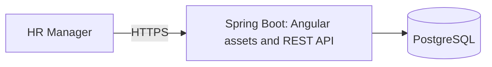

# Architecture and Engineering Decisions

**Status:** Approved project design for the MVP. Incubyte's clarification remains pending; this is not a statement of additional assessment requirements. The backend, PostgreSQL/Flyway foundations, employee creation/retrieval/editing through HTTP/service/persistence, session/CSRF security, and authenticated reference-data lookup are implemented. Employee listing, analytics HTTP endpoints, and UI remain planned.

## Context and Goals

The [requirements baseline](REQUIREMENTS.md) covers current employee salary management and predefined compensation reporting for 10,000 employees across multiple countries. The design prioritizes monetary correctness, readable code, testable business rules, and reliable delivery. Open product rules remain in [ASSUMPTIONS.md](ASSUMPTIONS.md).

## Architecture Choice

Use a modular monolith: one Spring Boot application, an Angular UI, and PostgreSQL. Organize the backend by feature, with layers inside features where useful. Use one backend build project and one application database; logical boundaries do not require separate Maven modules or databases.

| Alternative | Benefit | Trade-off | Decision |
| --- | --- | --- | --- |
| Application-wide controller/service/repository packages | Familiar, simple starting point | A feature's behavior becomes scattered across global layers | Keep these responsibilities within feature boundaries instead. |
| Modular monolith | Clear responsibilities, local calls, straightforward transactions, one deployment | Boundaries depend on code structure and review | Selected for the current scope. |
| Microservices | Independent deployment and scaling | Network failures, distributed consistency, and operational overhead | No present requirement justifies these costs. |

The backend bootstrap uses Java 21, Spring Boot 4.1.1, Spring MVC, and Maven Wrapper pinned to Maven 3.9.11 under `backend/`, with package `com.acme.salarymanagement`. The test starter follows Boot's managed JUnit Jupiter 6 and Mockito versions; the user approved JUnit 6 in place of the original JUnit 5 preference. The wrapper verifies the Maven distribution with a pinned SHA-256 checksum.

PostgreSQL 18.6 runs locally through Docker Compose with loopback access and a persistent project volume. The backend uses the Boot Flyway starter, PostgreSQL-specific Flyway module, and JDBC driver. Testcontainers supplies isolated PostgreSQL databases for integration tests, run by Maven Failsafe during `verify`. Credentials are external to Git; application startup requires configured PostgreSQL and successful migrations.

Spring Data JPA is implemented for employee persistence and immutable reference-data mappings. Spring Security uses Boot's managed 7.1.1 version. Jakarta Bean Validation uses Boot's validation starter for required HTTP fields. Modern Angular, TypeScript, Angular Material, Reactive Forms, and HttpClient remain the frontend direction; version selection and Angular acceptance are still pending. The [README](../README.md) documents Java selection, build, database setup, and local execution.

## Responsibilities and Boundaries

| Area | Owns | Boundary |
| --- | --- | --- |
| Employee management | Employee identity, department/country details, listing, search, and employee use cases | Coordinates employee workflows; does not duplicate compensation rules. |
| Reference data | Supported department, country, and currency catalogs and their read API | Migration-controlled records; employee validation and forms use the same catalogs. |
| Compensation | Salary amount/currency validation and current compensation changes | Keeps monetary rules out of controllers and UI components. |
| Analytics | Read-only summaries and database aggregation queries | Does not change employee or compensation records. |
| Security | Authentication, sessions, and access enforcement | Application code must not rely on frontend guards as authorization. |
| Infrastructure | Persistence configuration, migrations, seeding, and operational configuration | Supplies technical integration without becoming a general-purpose business module. |

The approved [data model](DATA_MODEL.md) uses `employees`, `departments`, `countries`, and `currencies`. Current salary fields belong to the employee record; employee management owns its entity and repository, while compensation owns salary validation/change rules. Employee application services coordinate combined changes in one transaction. Logical boundaries do not require a separate compensation table or endpoint.

Analytics may query employees and their reference tables through dedicated read projections. We accept internal schema coupling to keep reporting efficient and straightforward. Persistence changes must therefore review affected analytics queries and tests. Controllers should not reach into another feature's repositories; cross-feature business coordination belongs in services.

Within a feature, controllers translate HTTP requests and responses, application services coordinate use cases and transactions, and repositories perform persistence. DTOs define API input/output; do not serialize persistence entities as public contracts. Start with manual mapping for small DTOs. Do not add mapper libraries, service interfaces, or factories without a concrete need.

Keep monetary calculations and validation independently testable. Spring and JPA integration can remain pragmatic; this design does not require a second framework-free entity model or repository abstraction for every operation.

`EmployeeCreationService` implements the first use case. It normalizes and validates input, resolves controlled reference records, invokes framework-free `SalaryRules`, and saves the employee in one transaction. The repository flushes inside the service so the exact employee-number unique constraint can be translated into a business conflict, including concurrent requests. Other integrity failures retain their original classification. No existence pre-check is required for correctness.

Reference repositories expose single-record and ordered catalog lookup only; their JPA mappings are immutable and have no public mutation methods. Employee/result mapping is small and manual. Application values use `Long`, `BigDecimal`, and `Instant`; HTTP DTOs explicitly implement string serialization and input parsing rather than expose persistence entities. `EmployeeDetails` supplies the six editable values to creation and editing. `EmployeeDataResolver` shares normalization, reference resolution, and monetary validation; `EmployeeWriteConflicts` shares precise unique-constraint translation. No generic CRUD layer is introduced.

The creation controller and DTOs live in `employee.api`; shared JSON configuration and controller error handling live in `api`. The controller delegates to the existing service. `@Valid` checks required fields, while the request mapper parses a positive integer-string department ID. Name normalization/Unicode limits, reference checks, and salary rules stay in the existing application code. Response mapping uses explicit strings for exact IDs, versions, money, and UTC timestamps. This small amount of manual mapping isolates the HTTP contract without a mapper dependency.

JSON configuration rejects unknown fields, trailing tokens, and number/boolean-to-string coercion across JSON API requests; form login is unaffected. Controller advice maps validation, duplicate conflicts, missing/stale employees, and MVC failures to the same Problem Details shape as security handlers. It omits rejected values, parser/database messages, and query strings. Unexpected failures log their exception type only; this limits diagnostic detail to avoid logging sensitive payloads.

`EmployeeQueryService` retrieves one employee and maps its application result inside a read-only transaction. A repository entity graph on `findById` fetches department, country, and currency with the employee; a PostgreSQL integration check verifies one prepared query and zero entity writes. The endpoint reuses `EmployeeResponse`, so creation and retrieval share exact string/UTC formatting. `PositiveId` centralizes the small parsing rule now needed by both department IDs and employee path IDs. Missing records have a specific business exception mapped to `404 EMPLOYEE_NOT_FOUND`.

The read-only transaction is a framework/database optimization hint, not an immutable domain model. Tests also compare the persisted record before and after retrieval. Fetching the three lookup records adds joins but avoids later lazy-loading queries and works with Open Session in View disabled. The query boundary and returned version support the future editing form; the backend update workflow is implemented separately.

`EmployeeUpdateService` loads the target through `findForEditById`, checks the submitted version, resolves/validates all replacement values, then mutates the managed entity and flushes in one transaction. ID, creation timestamp, and JPA-managed version cannot be assigned by the request. Invalid values and unique conflicts roll back the entire replacement. Only effective changes update employee fields/metadata; decimal comparison ignores insignificant trailing zeros for no-change detection.

The edit query uses `LockModeType.OPTIMISTIC` on the employee without a fetch graph. Applying that lock to fetched unversioned lookup entities caused a provider error in testing; lookups are resolved separately for editing. Plain retrieval retains its efficient graph. Optimistic verification persists through commit, protecting unchanged submissions as well as writes. Explicit version mismatches and JPA/Spring optimistic failures map to `409 STALE_EMPLOYEE`; there is no automatic retry or forced version increment.

`ReferenceDataQueryService` reads the three small supported catalogs through ordered repository queries in one read-only transaction. It maps entities to typed application results inside that transaction; `referencedata.api` owns the controller and explicit HTTP DTOs, including exact string department IDs and integer minor units. Departments are ordered by database name/ID, countries/currencies by code. The existing security configuration protects the endpoint without new exceptions or CSRF requirements for GET.

One combined response simplifies form initialization and keeps catalog values aligned with backend validation. Three small reads and manual DTO mapping are accepted; there is no cache, pagination, or administration API. Catalogs remain controlled through migrations, so the default transaction isolation is sufficient for the current use case; this is not an atomic-snapshot guarantee for live catalog administration. New supported records can be added through reviewed migrations without Angular hardcoding. Large or dynamically administered catalogs would require separately approved pagination, consistency, and cache-invalidation decisions.

The Angular UI should follow the same feature responsibilities, with typed API services, reactive forms, and clear loading, empty, and error states. Share components when reuse exists. UI validation improves feedback; backend validation remains authoritative. The approved [API contract](API.md) uses `/api/v1`, decimal strings for money, integer strings for IDs/versions, application-owned page responses, and Problem Details errors.

## Runtime and Deployment Structure

Build Angular into static assets packaged with Spring Boot for production. This creates one application deployment plus PostgreSQL and one public origin for browser/API traffic. Spring Boot supports static resources and an index page; client-side route fallback still needs explicit implementation. The fallback must preserve API/authentication errors and missing-asset responses rather than return the UI for every unknown URL.

During development, run Angular separately and proxy backend requests through its development server. Use relative API URLs so browser requests follow the same-origin pattern.

The trade-off is coupled frontend/backend releases and a build process that assembles both artifacts. A later move to separate static hosting can retain the API boundary but requires packaging, routing, and security configuration changes. Docker is used for local PostgreSQL and isolated integration tests; production hosting, HTTPS termination, frontend packaging, and production container use remain undecided. No production infrastructure is created by local database setup.

## Demo Access

Use Spring Security with one configured HR account and session-based login. Protect employee and analytics APIs, including reads. Provide login and logout through the UI. Supply the username and password hash through deployment configuration; keep credentials out of the repository and application logs. Account registration, password recovery, user administration, and advanced RBAC remain outside the MVP.

Use an HTTP-only session cookie, secure over HTTPS in deployment, with `SameSite=Lax` and a 30-minute idle timeout. Retain CSRF protection. The [API contract](API.md) defines token initialization, login, session inspection, and logout, with a separate readable `XSRF-TOKEN` cookie and `X-XSRF-TOKEN` header. Refresh the token after login/logout; the authentication cookie stays HTTP-only. Spring Security handlers return API status/problem bodies instead of HTML redirects.

| Alternative | Trade-off |
| --- | --- |
| HTTP Basic | Less UI work, but awkward browser logout behavior. |
| Session login | Selected: conventional login/logout with server-side session management; requires correct cookie and CSRF integration. |
| External identity provider | Additional account/service configuration beyond the current demo need. |

Spring Security is implemented through one servlet security configuration, a small authentication controller, and security-filter Problem Details handlers. `InMemoryUserDetailsManager` holds the externally configured account; BCrypt verifies its supplied hash. Configuration rejects absent/malformed credentials without generating a fallback account. Credential properties have a redacted string representation. No account table is required for the approved single-account model.

Spring Security 7.1's SPA CSRF configuration supplies the Angular cookie/header behavior without a custom token handler. The CSRF endpoint materializes the token and returns no body. Login/logout remain framework-managed. A small filter between CSRF validation and login authentication enforces the URL-encoded login content type. Request caching and HTTP Basic are disabled; all paths except the explicit public auth requests require authentication. Error dispatches may reach the framework error controller, preserving authenticated missing-route responses.

Session and CSRF cookies default to Secure and `SameSite=Lax`; the session cookie is HTTP-only, uses cookie-only tracking, and expires after 30 minutes of inactivity. The `local` profile explicitly disables Secure for HTTP development. Security configuration/controllers apply only to servlet applications, so framework-free service tests and non-web persistence tests do not need HR credentials; every web application still requires them.

A shared configured account provides no individual attribution. In-memory sessions support the initial single-instance application; a restart requires login again. Multiple application instances would require an explicit session strategy. Use synthetic data exclusively; this demo access model is not a complete production HR identity-management system.

## Data, Money, and Transactions

Use Java `BigDecimal` and PostgreSQL `NUMERIC(19,4)` for positive gross annual base salary with explicit ISO currency codes. Validate currency-specific precision before persistence, because PostgreSQL can round excess scale. Reject non-finite values explicitly. Preserve currencies and separate monetary aggregation by currency. Do not infer currency from employment country or introduce conversion rates.

Paginate and aggregate in PostgreSQL rather than loading the entire dataset into the application or browser. Initial tables, constraints, indexes, and reference data are implemented in two versioned Flyway migrations. Flyway is the sole schema initializer; basic SQL initialization is disabled and Flyway clean is disabled. Hibernate validates the schema without mutating it. Open Session in View is disabled; the creation service maps its result within its transaction. Applied migrations evolve through new versions.

Application services define transaction boundaries for use cases. The employee has one JPA-managed optimistic-lock version. Creation metadata remains database-generated through Hibernate. `DatabaseClock` reads PostgreSQL's transaction timestamp using transaction-aware `JdbcTemplate`; creation and effective updates explicitly assign `updated_at` from it. This adds a clock query per actual write and avoids dependence on the application machine's clock. It also avoids the generated-update-returning path, which reported a generic generated-values failure instead of an optimistic conflict for a zero-row stale update in this configuration. Unchanged submissions skip the clock query and preserve metadata.

Required fields, foreign keys, unique employee numbers, case-insensitive department uniqueness, and indexes are specified in [DATA_MODEL.md](DATA_MODEL.md). The [API contract](API.md) defines validation/conflict responses, exact strings, and analytics rounding. Creation/editing rules and optimistic failure responses are implemented; consistent-snapshot analytics and frontend conflict recovery remain later steps.

## Verification Strategy

- Test observable business rules with fast, deterministic unit tests and Red -> Green -> Refactor where applicable.
- Verify persistence, constraints, pagination, and aggregation against PostgreSQL; do not assume a substitute database proves PostgreSQL behavior.
- Check analytics against independently calculated fixtures, including separate currencies and empty groups.
- Test API validation and access enforcement, login/logout/session behavior, and CSRF failures.
- Test important Angular forms, listing/filtering interactions, and loading/error states; verify the integrated UI/API workflow.
- Measure the realistic 10,000-record workload before making performance claims. Performance targets and integration-test environment setup remain open.

Migration/reference-data/constraint checks run in `FlywayMigrationIT`. `EmployeePersistenceIT` covers creation/retrieval/editing and uses coordinated transactions to verify that competing edits cannot both commit and an unchanged submission rejects a writer that commits before it. Unit/MVC tests cover validation, IDs, precise integrity classification, security configuration, and safe error mappings, including persistence optimistic failures. `SessionSecurityIT` verifies sessions/CSRF. `EmployeeApiIT` covers exact contracts, validation/rollback, metadata/no-change behavior, stale forms, and concurrent conflicts. `ReferenceDataApiIT` covers complete ordered catalogs, current database values, exact large IDs and minor units, empty arrays, access enforcement, GET without CSRF, media types, and absent write handlers. Integration tests use isolated PostgreSQL; HTTP suites use Java HttpClient and real embedded servers. Listing, analytics, and frontend checks remain planned. `verify` runs integration tests and requires Docker. Cookie flag checks do not establish deployed TLS/proxy readiness.

## Future Expansion

| Change | Extension path | Accepted current limit |
| --- | --- | --- |
| Salary history and audit records | Add effective-dated records/audit persistence through migrations; revise update and reporting semantics | Current-value editing provides no history or attribution trail. |
| RBAC and individual identities | Extend the security boundary with user identities, permissions, and authorization tests | One HR account has uniform access. |
| CSV import/export | Reuse validation and use-case rules; define duplicate handling and partial-failure behavior | No file-transfer workflow is implemented. |
| Currency conversion | Add rate sources, effective dates, and an explicit rounding/reporting policy | No single monetary total spans currencies. |
| Larger datasets | Measure queries, tune indexes and pagination, then consider scaling based on evidence | No claim of readiness for 100,000 or one million employees. |
| Separate frontend deployment or multiple backend instances | Revisit asset hosting/security configuration and session handling | One application deployment and local sessions simplify the MVP. |

Clear boundaries make changes easier to locate; they do not guarantee future features will require no refactoring. Do not introduce speculative infrastructure or abstractions to implement these extension paths now.

## References

- [Spring Boot servlet web applications and static resources](https://docs.spring.io/spring-boot/reference/web/servlet.html)
- [Spring Security session management](https://docs.spring.io/spring-security/reference/servlet/authentication/session-management.html)
- [Spring Security CSRF and SPA integration](https://docs.spring.io/spring-security/reference/servlet/exploits/csrf.html)
- [Angular security and HttpClient CSRF integration](https://angular.dev/best-practices/security)
- [Hibernate database-sourced creation timestamps](https://docs.hibernate.org/orm/current/javadocs/org/hibernate/annotations/CreationTimestamp.html)
- [Spring MVC request-body validation](https://docs.spring.io/spring-framework/reference/web/webmvc/mvc-controller/ann-methods/requestbody.html)
- [Spring MVC Problem Details support](https://docs.spring.io/spring-framework/reference/web/webmvc/mvc-ann-rest-exceptions.html)
- [Spring Data JPA entity graphs](https://docs.spring.io/spring-data/jpa/reference/jpa/query-methods.html#jpa.entity-graph)
- [Spring Data JPA transaction boundaries and read-only behavior](https://docs.spring.io/spring-data/jpa/reference/jpa/transactions.html)
- [Jakarta Persistence optimistic locking and commit-time verification](https://jakarta.ee/specifications/persistence/3.2/jakarta-persistence-spec-3.2.html)
