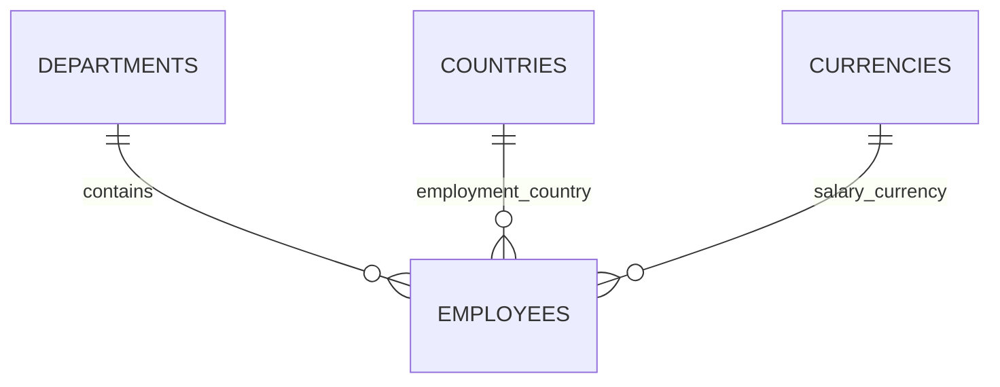

# Employee Salary Data Model

**Status:** Approved project design for the MVP, subject to Incubyte clarification. This document defines the model; no database, entity classes, or executable migrations have been created.

## Context and Scope

The [requirements](REQUIREMENTS.md) cover current employee and compensation management, database-side listing, and predefined analytics. The [architecture](ARCHITECTURE.md) uses a modular monolith with PostgreSQL. Product assumptions and unresolved rules remain in [ASSUMPTIONS.md](ASSUMPTIONS.md).

Use four tables: `employees`, `departments`, `countries`, and `currencies`. Every employee has exactly one current salary, department, employment country, and salary currency. Reference records may be used by zero or many employees.

## Employee Record

| Column | Proposed PostgreSQL type | Purpose and constraints |
| --- | --- | --- |
| `id` | `BIGINT` identity | Internal primary key; stable independently of the HR employee number. |
| `employee_number` | `VARCHAR(32)` | Required, unique, normalized uppercase identifier. Exact syntax and editability remain for Step 7. |
| `full_name` | `VARCHAR(200)` | Required and nonblank; support international names without imposing a first/last-name split. |
| `department_id` | `BIGINT` | Required foreign key to `departments.id`. |
| `country_code` | `VARCHAR(2)` | Required foreign key to `countries.code`; employment country. |
| `salary_amount` | `NUMERIC(19,4)` | Required, finite, positive gross annual base salary. |
| `currency_code` | `VARCHAR(3)` | Required foreign key to `currencies.code`; independent of employment country. |
| `version` | `BIGINT` | Optimistic concurrency version, managed by JPA rather than assigned by the client. |
| `created_at` | `TIMESTAMPTZ` | System-managed creation metadata. |
| `updated_at` | `TIMESTAMPTZ` | System-managed latest-change metadata. |

Database constraints must enforce required values, uniqueness, valid references, nonblank names, and positive finite salary amounts. Application validation provides understandable errors before persistence; database constraints remain the final protection against invalid structural state.

Creation/latest-change timestamps provide operational metadata, not salary history, an audit log, or individual attribution. Exact timestamp initialization and API formatting belong to implementation/API design.

## Reference Data

| Table | Columns | Rules and purpose |
| --- | --- | --- |
| `departments` | Identity `id`; required `name VARCHAR(100)` | Primary key and case-insensitive name uniqueness prevent duplicate reporting labels. Names must be nonblank. |
| `countries` | ISO alpha-2 `code`; required display `name` | Uppercase, two-letter primary key identifies an employment country. |
| `currencies` | ISO `code`; required display `name`; `minor_units SMALLINT` | Uppercase, three-letter primary key and required minor-unit count from 0 through 4. |

Use `VARCHAR(2)` for country codes and `VARCHAR(3)` for currency codes. Code-shape constraints and foreign keys do not establish ISO validity by themselves; reference records must come from a verified, supported catalog. Final display-name lengths and reference records will be settled before migrations and seeding.

Reference records are controlled through migrations initially. The employee seed script uses those supported records to generate 10,000 synthetic employees. No reference-data administration UI is included in the MVP.

Referenced lookup records cannot be cascade-deleted. Foreign keys prevent invalid references and removal of lookup records still in use. Employee deletion is outside the current product scope.

Country and currency remain independent. The model must allow an employee to be paid in a supported currency other than the currency commonly associated with their employment country.

## Monetary Storage and Validation

Use Java `BigDecimal` and PostgreSQL `NUMERIC(19,4)` for exact decimal storage. This permits fifteen integral digits and up to four fractional digits. The representational ceiling is a technical storage boundary, not an approved business salary maximum.

Before persistence, validate that an amount is positive, representable in the column, and compatible with the selected currency's minor units. Reject meaningful excess precision rather than silently rounding. Insignificant trailing zeros may be accepted. Do not use binary floating-point calculations for money.

PostgreSQL rounds input exceeding a declared numeric scale before storing it. Therefore the fixed-scale column alone cannot enforce our rejection policy. Both application writes and the seed script must validate before persistence. Direct SQL that bypasses validation can still round excess precision; avoid introducing triggers or cross-table precision machinery for the MVP.

The database salary constraint must explicitly reject `NaN`; a positive-value check alone is insufficient because PostgreSQL orders `NaN` above ordinary numeric values. Bounded numeric storage excludes infinity, and explicit finite/range checks should be verified in migration tests.

Currency-specific precision uses the supported currency record's metadata. A three-letter code is not sufficient validation. Changing supported metadata later requires reviewing existing salaries; do not silently reinterpret stored amounts.

Group monetary analytics by currency. Salary totals may exceed the per-employee storage range, so aggregation must not narrow results back into the employee column type. Average rounding, output precision, and browser/API monetary representation remain Step 7 decisions. There is no exchange-rate conversion.

## Persistence Ownership and Transactions

- Employee management owns the employee entity and repository, including persistence of its current salary fields.
- Compensation owns amount/currency validation and salary-change rules. Employee use cases invoke these rules rather than duplicating them.
- Employee application services coordinate combined employee/compensation changes in one transaction. Failure must roll back the whole change.
- Analytics owns read-only database projection queries. It does not update employee or salary records.
- Infrastructure owns migration and reference-data initialization mechanisms.

Use one employee version field for the aggregate. JPA optimistic locking detects concurrent persistence updates. The API must also carry the version originally edited by the user and check it; fetching the newest entity on submission without checking that original version would still allow a stale browser form to overwrite newer data.

Conflict-response details belong to Step 7. Do not silently retry stale updates and overwrite the intervening change.

## Initial Indexes and Query Boundaries

Start with primary-key indexes, employee-number uniqueness, case-insensitive department-name uniqueness, and employee indexes on `(department_id, id)` and `(country_code, id)` for filtered listing. Do not duplicate indexes already supplied by primary-key or unique constraints.

Use the unique employee ID as the final pagination sort tie-breaker. This provides a deterministic order for an unchanged dataset, not snapshot consistency while records are being edited.

Finalize additional indexes against Step 7's query contracts. Do not index every sortable field. Ordinary B-tree indexes do not generally accelerate arbitrary substring searches such as `%name%`; measure the 10,000-record workload before adding a specialized index or database extension. Combined filters and alternate sort orders may require different plans; the proposed indexes are a starting point, not a performance guarantee.

Analytics remains database-side aggregation. Do not add materialized summaries, caches, partitioning, or distributed infrastructure without a demonstrated requirement.

## Alternatives and Trade-offs

| Alternative | Decision and accepted trade-off |
| --- | --- |
| Current salary columns on `employees` | Selected: one required current salary, straightforward lifecycle, updates, and versioning. Compensation remains a separate business responsibility. |
| Separate one-to-one current salary table | Deferred: adds joins and lifecycle coordination without a current independent lifecycle. |
| Salary-history table now | Excluded: implements deferred product scope. |
| Free-text department, country, and currency | Rejected: fewer tables but inconsistent filtering/reporting values and weaker reference integrity. |

## Planned Verification

When executable migrations and features are approved, verify against PostgreSQL:

- Required fields, nonblank names, identifier uniqueness, and case-insensitive department uniqueness.
- Foreign keys, valid supported codes, minor-unit limits, and prevention of cascading lookup deletion.
- Rejection of zero, negative, `NaN`, and out-of-range salary values.
- Exact round trips, currency-specific precision rejection, insignificant trailing zeros, and validation before database coercion.
- Atomic employee/compensation updates and stale-edit conflicts, including two browser clients editing the same version.
- Filtered pagination with a unique sort tie-breaker and independently calculated, separate-currency analytics.

These database/application tests are planned, not executed. This documentation step checks scope consistency, local links, formatting, and secret patterns.

## Future Expansion

History would add effective-dated compensation records through migrations and require changes to update/reporting semantics. Existing current salary fields could be migrated or retained as an explicitly managed current view; that choice is deferred until history is required.

Audit records and individual identities would need additional persistence and attribution rules. They are not supplied by the version or timestamp columns. Additional supported currencies/countries can be introduced through reviewed reference-data changes, subject to the storage and precision policy. A currency requiring more than four fractional digits would require a schema/policy change.

Larger workloads require measured query/index tuning and possibly revised pagination. Clear ownership helps locate changes but does not eliminate migration work or prove readiness for 100,000 or one million employees.

## References

- [PostgreSQL numeric types, coercion, and special values](https://www.postgresql.org/docs/current/datatype-numeric.html)
- [PostgreSQL constraints and referential integrity](https://www.postgresql.org/docs/current/ddl-constraints.html)
- [PostgreSQL index capabilities](https://www.postgresql.org/docs/current/indexes-types.html)
- [Java 21 currency metadata](https://docs.oracle.com/en/java/javase/21/docs/api/java.base/java/util/Currency.html)
- [Jakarta Persistence versioning](https://jakarta.ee/specifications/platform/11/apidocs/jakarta/persistence/version)
