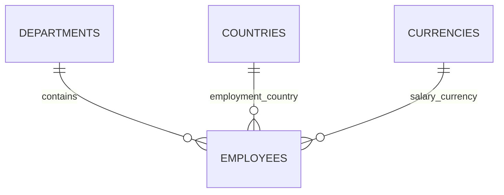

# Employee Salary Data Model

Implemented by [V1 schema](../backend/src/main/resources/db/migration/V1__create_salary_management_schema.sql) and [V2 catalogs](../backend/src/main/resources/db/migration/V2__insert_reference_data.sql). Flyway owns evolution; Hibernate validates. Product rules remain in [API.md](API.md), rationale in [ARCHITECTURE.md](ARCHITECTURE.md).

## Employee Record

Every employee has one required current salary, department, employment country, and independent salary currency.

| Column | PostgreSQL type | Constraint / purpose |
| --- | --- | --- |
| `id` | `BIGINT` generated identity | Stable primary key, independent of editable employee number. |
| `employee_number` | `VARCHAR(32)` | Required unique normalized ASCII identifier. |
| `full_name` | `VARCHAR(200)` | Required nonblank international name; no first/last split. |
| `department_id` | `BIGINT` | Required department foreign key. |
| `country_code` | `VARCHAR(2)` | Required country foreign key. |
| `salary_amount` | `NUMERIC(19,4)` | Required positive finite current annual salary. |
| `currency_code` | `VARCHAR(3)` | Required currency foreign key. |
| `version` | `BIGINT` | Required nonnegative, default 0, JPA-managed. |
| `created_at`, `updated_at` | `TIMESTAMPTZ` | Required; transaction-time defaults. |

Application writes source timestamps from PostgreSQL and map them to `Instant`; effective changes update time/version, normalized no-change saves preserve them. These are operational metadata, not salary history or individual audit attribution. The client supplies an original-version precondition; services keep combined employee/compensation changes atomic.

## Reference Tables

| Table | Definition |
| --- | --- |
| `departments` | Identity `id`; nonblank `name VARCHAR(100)` with case-insensitive uniqueness. |
| `countries` | Uppercase two-letter primary key `code`; nonblank `name VARCHAR(100)`. |
| `currencies` | Uppercase three-letter primary key `code`; nonblank `name VARCHAR(100)`; `minor_units SMALLINT` in 0..4. |

Code shape alone does not prove ISO validity; supported records are migration-controlled. V2 contains Engineering, Finance, HR, Sales, Marketing, Operations, Customer Support, Legal; countries IN/US/GB/DE/JP/KW; currencies INR/USD/GBP/EUR/JPY/KWD. JPY has 0 minor units, KWD 3, others 2, checked against [SIX ISO 4217 metadata](https://www.six-group.com/dam/download/financial-information/data-center/iso-currrency/lists/list-one.xml).

Required foreign keys use `ON DELETE RESTRICT`; lookup records still in use cannot be deleted. No cascade deletion, employee deletion workflow, or catalog administration is implemented. Reference extensions require new migrations; precision changes require reviewing existing amounts.

## Monetary Integrity

`BigDecimal` / `NUMERIC(19,4)` preserve exact values with fifteen integral and four fractional digits. Amounts must be below `10^15` and fit the selected currency's meaningful precision; insignificant trailing zeros are allowed. This technical ceiling is not a business salary maximum.

PostgreSQL coerces excess scale before storage, so application and seed validation reject excess precision before insertion. Direct SQL can bypass that policy and round; no cross-table precision trigger is added. The salary check explicitly excludes `NaN`, because a simple positive check would accept it in PostgreSQL's ordering; bounded NUMERIC excludes infinity.

Analytics keeps currencies separate and does not narrow totals back to the employee column type. Full formatting/rounding rules are in the [API contract](API.md).

## Indexes and Query Boundaries

Primary/unique indexes cover IDs, employee number, and case-insensitive department name. Additional employee indexes are `(department_id, id)` and `(country_code, id)`. Do not duplicate constraint indexes or add an index for every sortable field without measurement.

Directory reads paginate in SQL with stable ID ties. Arbitrary `%substring%` search is not generally accelerated by ordinary B-tree indexes. Analytics reads grouped projections rather than all employees. Count/page consistency, query costs, and larger-scale limits are documented in [architecture](ARCHITECTURE.md).

## Ownership, Verification, and Expansion

Employee management owns the entity/repository; compensation owns money validation; employee services own write transactions; analytics owns read projections; infrastructure owns migrations. Current salary columns avoid a one-to-one table without an independent lifecycle. History would require effective-dated records and revised update/report semantics.

`FlywayMigrationIT` checks fresh/repeated migrations, catalogs, constraints, exact decimals, defaults, and protected lookup deletion in disposable PostgreSQL. The original red run found zero migrations before SQL was added. Delete restriction uses SQLSTATE `23001`, distinct from invalid-reference `23503`. Persistence/API/seed suites cover precision before coercion, committed writes, races, bounded reads, and complete seed rollback. See [coverage](COVERAGE_REVIEW.md) and [actual run evidence](VERIFICATION.md).

No applied migration was rewritten for JPA, editing, listing, analytics, or seeding. Flyway alone creates catalogs and zero employees; [seed modes](../backend/TECHNICAL_DOCUMENTATION.md#synthetic-data-seeding) populate employees separately. Generated IDs/timestamps are not deterministic.

Future history, audit, identity, or precision above four digits requires versioned schema changes. Clear ownership locates these changes; it does not promise zero refactoring or proven million-row capacity.

References: [PostgreSQL numeric coercion](https://www.postgresql.org/docs/current/datatype-numeric.html), [constraints](https://www.postgresql.org/docs/current/ddl-constraints.html), [error codes](https://www.postgresql.org/docs/current/errcodes-appendix.html).
